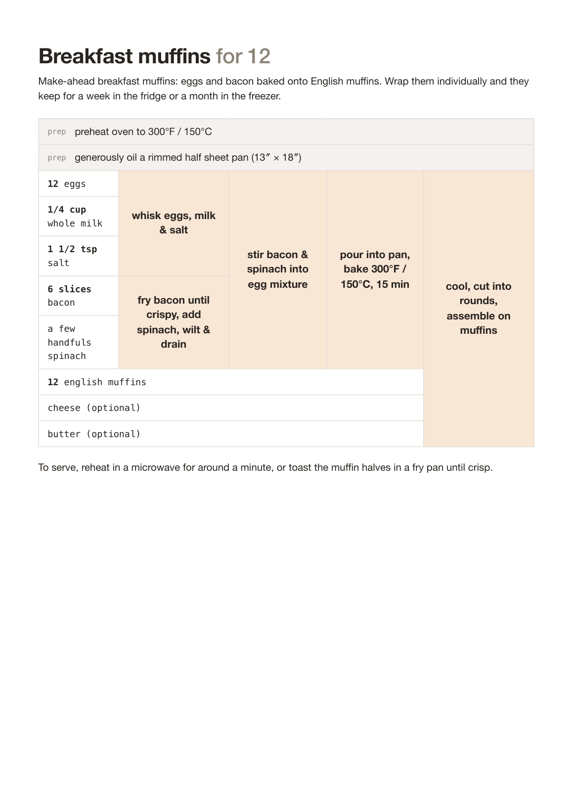

# recipe-grid-pretty-print

Beautiful, print-ready HTML recipe tables from
[recipe grid](https://github.com/mossblaser/recipe_grid) source files — in the
style of [recipetables.com](https://recipetables.com/how-it-works).

Write your recipe in the plain-text recipe grid language (inside any Markdown
file), then render it to a single standalone HTML page designed to be printed
to PDF from any browser:



* Ingredients run down a left-hand column in monospace with bold quantities
* Steps occupy peach cells spanning the rows of their inputs, in bold
  centred sans-serif — read the recipe left to right, top to bottom
* Steps without ingredients (preheating the oven, oiling the pan) become
  full-width grey **prep** rows above the grid
* Named sub-recipes (written with `:=`) are outlined blocks with a title bar
* Print-first CSS: tables split cleanly **between rows** across pages,
  sub-recipe headers never get orphaned at the bottom of a page, colours
  survive printing, and page size/margins are pre-tuned for A4 or Letter

The generated HTML is completely standalone (no external fonts, images or
stylesheets), so it can be archived, emailed, or committed alongside the
source recipe.

## Installation

```bash
pip install .
```

(or `uv pip install .`) — requires Python 3.9+ and pulls in
[`recipe_grid`](https://pypi.org/project/recipe_grid/) as a dependency.

## Usage

```bash
recipe-grid-pretty-print my_recipe.md              # writes my_recipe.html
recipe-grid-pretty-print my_recipe.md out.html     # explicit output
recipe-grid-pretty-print my_recipe.md -            # write to stdout
```

Options:

| Option | Description |
| ------ | ----------- |
| `--paper a4\|letter` | Tune margins and page size (default: `a4`) |
| `--orientation portrait\|landscape` | Page orientation (default: `portrait`) |
| `--scale N` / `-S` | Scale all quantities (e.g. `2`, `0.5`, `1 1/2`) |
| `--servings N` / `-s` | Scale to N servings (title must say e.g. "... for 4") |
| `--accent CSS_COLOUR` | Override the peach step-cell colour |
| `--no-toolbar` | Omit the on-screen print toolbar |

Then open the file in a browser and **Cmd/Ctrl+P → Save as PDF**. Enable
"Background graphics" in the print dialog to keep the colours (the toolbar
reminds you of this and is hidden when printing).

### Python API

```python
from recipe_grid_pretty_print import render_file, render_source

html = render_file("my_recipe.md", paper="letter")
html = render_source(source_string, scale=2, orientation="landscape")
```

## Writing recipes

Recipes use the [recipe grid language](https://mossblaser.github.io/recipe_grid/)
in indented blocks within an ordinary Markdown file. A quick taster:

```markdown
Pancakes for 4
==============

    200g plain flour
    2 eggs
    300ml milk

    batter := "whisk together until smooth" (flour, eggs, milk)
    "fry in ladlefuls until golden" (batter, butter)
```

Each ingredient becomes a row; each step becomes a cell to the right of its
ingredients; steps using the output of earlier steps stack into further
columns to the right. Ingredients and steps used only once are inlined into
where they are used.

### Prep steps

The recipe grid language requires steps to have inputs, but recipe tables
read best when ingredient-free preparation steps ("preheat the oven") sit in
full-width rows above the grid. This library supports them with a simple
convention: give the step a dummy ingredient whose name starts with an
underscore:

```markdown
    "preheat oven to 300°F / 150°C" (_oven)
    "generously oil a rimmed half sheet pan" (_pan)
```

These are hoisted out of the grid into grey **prep** rows and the dummy names
are hidden. Dummy ingredients mixed in with real ones are simply hidden:

```markdown
    "fry the onions" (1 onion, _pan)
```

Use each dummy name only once (`_oven`, `_pan`, `_trays`, ...).

### Syntax tips

* Step and ingredient names containing `,` `(` `)` `/` `:` or `=` must be
  quoted: `"fry until crispy, stirring" (bacon)`
* Unusual units can be forced with curly brackets: `{6 slices} bacon`
* Numbers in `{...}` scale with the recipe: `divide into {4} portions`
* Sub-recipes named with `:=` (rather than `=`) stay visible as outlined,
  titled blocks instead of being inlined
* Check recipes for unused/mistyped ingredients with the upstream
  `recipe-grid-lint` tool

## Page-break behaviour

The generated page prints exactly what it shows: the on-screen sheet is laid
out at the true paper size with the true print margins, and an embedded
script (no dependencies, no network) computes where each page will break
*before you print*:

* Table rows are grouped into atomic blocks — a step cell always stays on
  the page as the ingredient rows it spans
* Breaks are stamped explicitly (`break-before: page`) at the start of
  whichever block would otherwise cross a page boundary, so the browser
  never improvises
* A step cell taller than a remaining page space is never sliced: it is cut
  cleanly at a row boundary and a matching *"(continued)"* cell opens the
  next page — **no cell ever straddles two pages**
* Sub-recipe title bars move to the next page with their rows, headings move
  with their content, and prose uses `orphans`/`widows`

The script is idempotent and re-runs on `beforeprint`. Without JavaScript a
CSS-only fallback applies (rows stay whole and sub-recipe headers keep their
rows, but very tall spanning cells may then be split by the browser).

## Development

```bash
uv venv && uv pip install -e . pytest
.venv/bin/python -m pytest
```

## Licence

MIT — see [LICENSE](LICENSE). recipe_grid is by Jonathan Heathcote
([mossblaser](https://github.com/mossblaser)); the table style is inspired by
[recipetables.com](https://recipetables.com).
